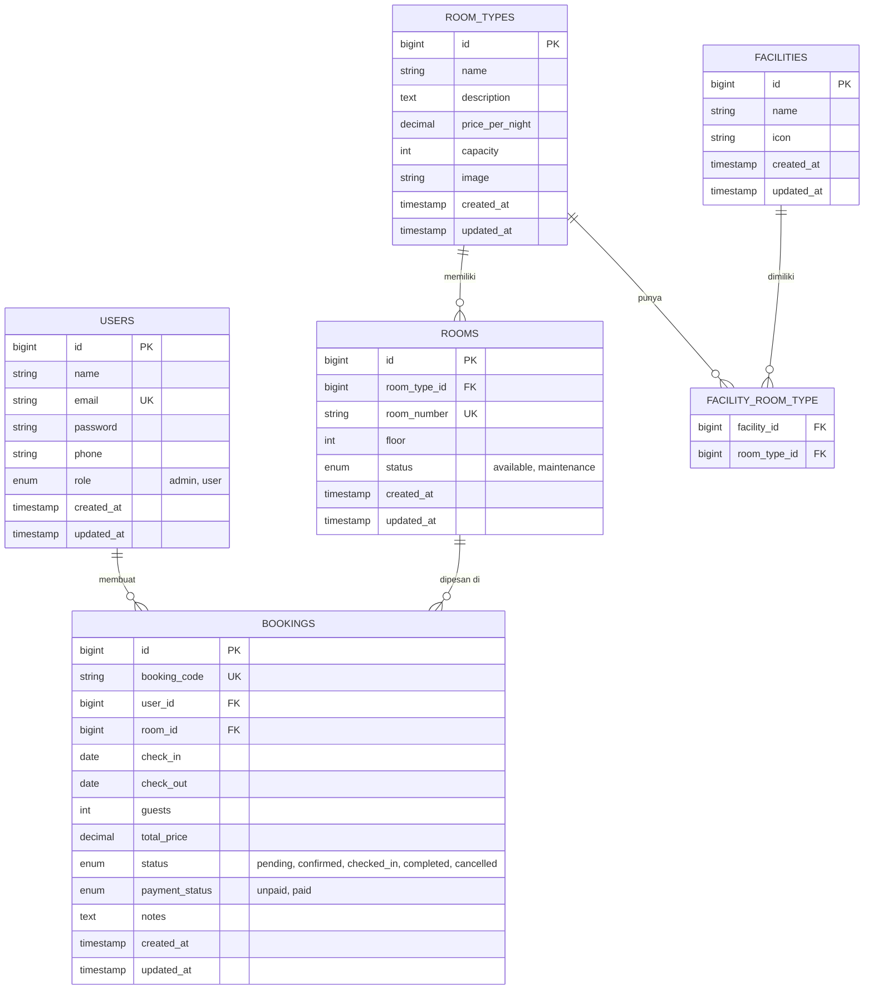

# Rancangan Sistem Booking TuruStay

Studi kasus Final Project: TuruStay, aplikasi web booking kamar hotel berbasis Laravel dan MySQL, dengan dua peran (tamu dan admin), CRUD kamar, dan manajemen booking.

**Nama produk:** TuruStay. "Turu" berarti tidur dalam bahasa Jawa sehari-hari, dan "Stay" adalah istilah umum di industri penginapan. Nama ini juga menjadi nama repository: `turustay-bookig-app`.

## Daftar isi

1. [Studi kasus](#1-studi-kasus)
2. [Peran dan fitur](#2-peran-dan-fitur)
3. [Rancangan database](#3-rancangan-database)
4. [ERD](#4-erd)
5. [Alur booking dan aturan bisnis](#5-alur-booking-dan-aturan-bisnis)
6. [Rencana implementasi CRUD di Laravel](#6-rencana-implementasi-crud-di-laravel)
7. [Repository GitHub kolaboratif](#7-repository-github-kolaboratif)

---

## 1. Studi kasus

Hotel kecil dan penginapan sering menerima pesanan lewat telepon atau chat, sehingga rawan bentrok jadwal dan sulit direkap. Aplikasi ini memungkinkan tamu melihat kamar, memilih tanggal menginap, dan memesan secara online, sementara admin mengelola kamar dan memantau semua booking dari satu dashboard.

**Ruang lingkup:** daftar dan login, katalog kamar, cek ketersediaan berdasarkan tanggal, booking, riwayat booking tamu, serta pengelolaan kamar dan booking oleh admin. Pembayaran online di luar cakupan; status pembayaran dicatat manual oleh admin.

## 2. Peran dan fitur

Akses dibedakan lewat kolom `role` pada tabel `users` (`admin` atau `user`) dan middleware Laravel.

| Fitur | Tamu (user) | Admin |
| --- | --- | --- |
| Registrasi dan login | Ya | Ya (akun dibuat lewat seeder) |
| Lihat daftar dan detail kamar | Ya | Ya |
| Cek ketersediaan per tanggal | Ya | Ya |
| Membuat booking | Ya | Tidak |
| Lihat dan batalkan booking sendiri | Ya | Tidak |
| CRUD tipe kamar | Tidak | Ya |
| CRUD kamar | Tidak | Ya |
| CRUD fasilitas | Tidak | Ya |
| Lihat semua booking | Tidak | Ya |
| Ubah status booking (konfirmasi, check-in, selesai, batal) | Tidak | Ya |
| Kelola data user | Tidak | Ya |

## 3. Rancangan database

Enam tabel di MySQL. Tipe kamar berperan sebagai "layanan", dan rentang tanggal check-in sampai check-out pada booking berperan sebagai "jadwal".

| Tabel | Kolom utama | Keterangan |
| --- | --- | --- |
| users | id, name, email (unik), password, phone, role (admin/user), timestamps | Akun tamu dan admin |
| room_types | id, name, description, price_per_night, capacity, image | Layanan yang dijual (Standard, Deluxe, Suite) |
| rooms | id, room_type_id (FK), room_number (unik), floor, status (available/maintenance) | Kamar fisik |
| facilities | id, name, icon | Master fasilitas (WiFi, AC, sarapan) |
| facility_room_type | facility_id (FK), room_type_id (FK) | Tabel pivot many-to-many |
| bookings | id, booking_code (unik), user_id (FK), room_id (FK), check_in, check_out, guests, total_price, status, payment_status, notes, timestamps | Transaksi booking |

**Relasi:**

- Satu user memiliki banyak booking (`users` 1 : N `bookings`).
- Satu tipe kamar memiliki banyak kamar (`room_types` 1 : N `rooms`).
- Satu kamar memiliki banyak booking pada tanggal berbeda (`rooms` 1 : N `bookings`).
- Tipe kamar dan fasilitas berelasi banyak ke banyak lewat `facility_room_type`.

**Nilai status booking:** `pending`, `confirmed`, `checked_in`, `completed`, `cancelled`.

## 4. ERD



**Daftar relasi:**

| Relasi | Kardinalitas | Foreign key | Keterangan |
| --- | --- | --- | --- |
| users - bookings | 1 : N | `bookings.user_id` | Satu user dapat membuat banyak booking |
| room_types - rooms | 1 : N | `rooms.room_type_id` | Satu tipe kamar punya banyak kamar fisik |
| rooms - bookings | 1 : N | `bookings.room_id` | Satu kamar dapat dipesan berkali-kali pada tanggal berbeda |
| room_types - facilities | N : M | `facility_room_type.room_type_id`, `facility_room_type.facility_id` | Dihubungkan lewat tabel pivot |

**Catatan ERD:**

- `PK` = primary key, `FK` = foreign key, `UK` = unique key.
- Tabel pivot `facility_room_type` memakai gabungan `facility_id` dan `room_type_id` sebagai primary key.
- Disarankan memberi `onDelete('restrict')` pada `bookings.room_id` dan `bookings.user_id` agar riwayat booking tidak ikut terhapus.

## 5. Alur booking dan aturan bisnis

1. Tamu login, lalu memilih tanggal check-in, check-out, dan jumlah tamu.
2. Sistem menampilkan tipe kamar yang punya minimal satu kamar kosong pada rentang tanggal itu.
3. Tamu memilih tipe kamar dan mengirim form booking.
4. Sistem memilih satu kamar kosong, menghitung total (malam × harga per malam), membuat kode booking, dan menyimpan dengan status `pending`.
5. Admin membuka daftar booking, memeriksa pembayaran, lalu mengubah status menjadi `confirmed`.
6. Saat tamu datang admin menandai `checked_in`, lalu `completed` setelah check-out.

**Aturan bisnis:**

- Check-out harus setelah check-in, dan check-in tidak boleh sebelum hari ini.
- Jumlah tamu tidak boleh melebihi kapasitas tipe kamar.
- Satu kamar tidak boleh punya dua booking aktif yang tanggalnya tumpang tindih. Dua rentang bentrok jika `check_in` lama < `check_out` baru dan `check_out` lama > `check_in` baru; booking berstatus `cancelled` diabaikan.
- Tamu hanya bisa membatalkan booking berstatus `pending`.
- Kamar berstatus `maintenance` tidak ikut dihitung sebagai kamar kosong.

## 6. Rencana implementasi CRUD di Laravel

CRUD utama untuk tugas 2 ada di tiga resource admin: tipe kamar, kamar, dan booking. Tampilan memakai Blade dengan Bootstrap 5.

| Resource | Model | Controller | Route | Akses |
| --- | --- | --- | --- | --- |
| Tipe kamar | RoomType | Admin\RoomTypeController | `Route::resource('admin/room-types')` | admin |
| Kamar | Room | Admin\RoomController | `Route::resource('admin/rooms')` | admin |
| Fasilitas | Facility | Admin\FacilityController | `Route::resource('admin/facilities')` | admin |
| Booking (admin) | Booking | Admin\BookingController | index, show, update status, destroy | admin |
| Booking (tamu) | Booking | BookingController | index, create, store, show, cancel | user |
| Katalog kamar | RoomType | RoomCatalogController | index, show | publik |

Langkah persiapan proyek:

```bash
composer create-project laravel/laravel turustay-bookig-app
cd turustay-bookig-app
composer require laravel/breeze --dev
php artisan breeze:install blade
# atur DB_DATABASE, DB_USERNAME, DB_PASSWORD di file .env
php artisan make:model RoomType -mc
php artisan make:model Room -mc
php artisan make:model Booking -mc
php artisan migrate --seed
```

Breeze menyediakan login dan registrasi. Tambahkan middleware `IsAdmin` yang memeriksa `auth()->user()->role === 'admin'`, lalu pasang pada grup route `admin/*`. Seeder membuat satu akun admin dan beberapa tipe kamar contoh.

## 7. Repository GitHub kolaboratif

Satu anggota (ketua tim) membuat repository, lalu mengundang semua anggota lain sebagai collaborator.

1. Di GitHub, klik **New repository**, beri nama `turustay-bookig-app`, pilih Private atau Public, lalu **Create repository**.
2. Buka **Settings** > **Collaborators** (di grup Access), klik **Add people**, masukkan username atau email GitHub tiap anggota, lalu pilih **Add to repository**. Repository private memakai pengaturan ini; jika repository berada di organisasi, menu aksesnya bisa berbeda.
3. Setiap anggota menerima undangan lewat email atau halaman notifikasi GitHub dan harus menerimanya (**Accept invitation**) sebelum bisa push.
4. Ketua mengunggah proyek Laravel pertama ke branch `main`:

```bash
cd turustay-bookig-app
git init
git add .
git commit -m "Initial commit: Laravel project"
git branch -M main
git remote add origin https://github.com/<username>/turustay-bookig-app.git
git push -u origin main
```

5. Anggota lain mengkloning repository, menyiapkan environment, dan bekerja di branch masing-masing:

```bash
git clone https://github.com/<username>/turustay-bookig-app.git
cd turustay-bookig-app
composer install
cp .env.example .env
php artisan key:generate
# isi konfigurasi database di .env, lalu:
php artisan migrate --seed

git checkout -b feature/crud-kamar
# kerjakan fitur, lalu:
git add .
git commit -m "Tambah CRUD kamar"
git push -u origin feature/crud-kamar
```

6. Buka **Pull request** di GitHub dari branch fitur ke `main`, minta minimal satu anggota lain mereview, lalu merge.

**Aturan tim yang disarankan:**

- Jangan commit file `.env`; Laravel sudah mengabaikannya lewat `.gitignore`, dan hanya `.env.example` yang dibagikan.
- Satu fitur satu branch, dengan nama seperti `feature/auth`, `feature/booking`, `feature/crud-kamar`.
- Jalankan `git pull origin main` sebelum mulai bekerja agar tidak bentrok.
- Pesan commit singkat dan jelas dalam satu bahasa yang sama.


~~MATUR SEMBAH NUWUN~~